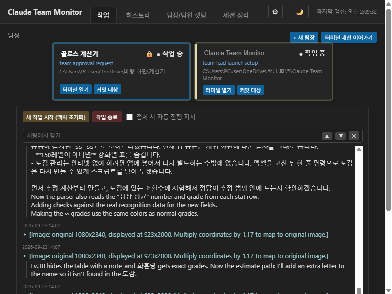
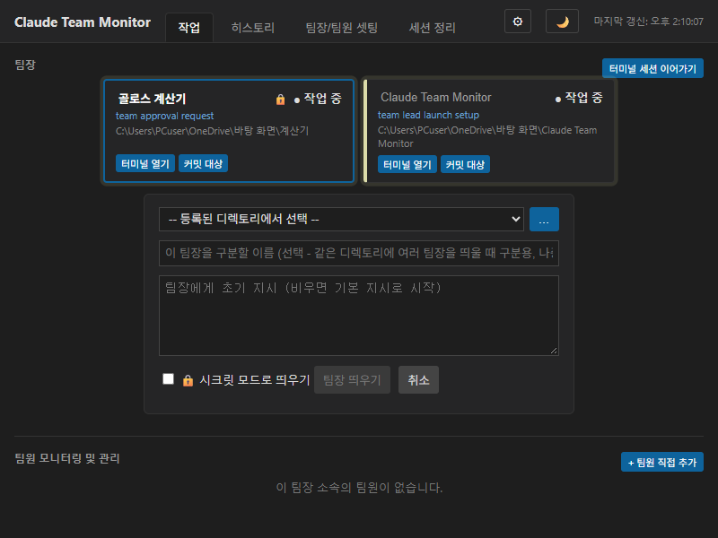
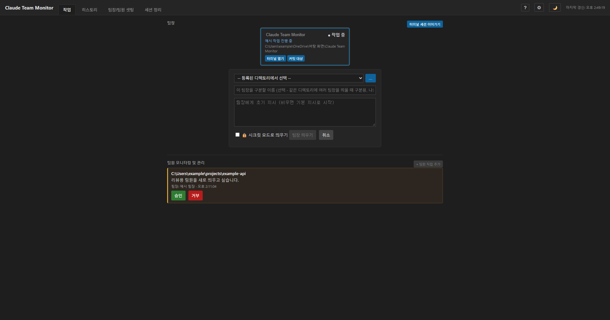

# Claude Team Monitor

[](https://github.com/gyeongho-you/claude-team-monitor/actions/workflows/ci.yml)

여러 저장소(repo)에 걸친 작업을 헤드리스 Claude Code 세션("팀장" 1개 + 필요한 만큼의 "팀원")으로 분담시키고, 진행 상황을 한 화면에서 모니터링·관리하는 도구입니다.

핵심은 **팀장 1명이 여러 repo에 팀원을 띄워 작업을 나누고, 결과를 종합해서 보고**하는 구조입니다. 이 저장소는 그 구조를 실제로 쓸 수 있게 해주는 두 가지를 담고 있습니다:

- **Claude Code 스킬**(`resources/skills/team-lead/SKILL.md`) — 팀장 세션이 따르는 행동 지침
- **MCP 서버** — 팀원 생성·자기등록을 위한 툴(`spawn_team_member`, `register_as_lead`, `list_leads`). 앱 실행 파일이 `--mcp-server`로 직접 맡습니다(`src-tauri/src/mcp_server.rs`, Node.js 불필요). 같은 동작의 Node 버전(`src/mcp/teamMemberServer.ts`)도 앱 없이 쓰는 경우를 위해 남아 있습니다.

데스크톱 앱(Tauri)은 이 위에 얹은 **부가 기능**입니다 — 여러 팀장/팀원을 화면 하나로 모아 보여주고, 승인 요청에 버튼으로 응답하고, 대화 히스토리를 관리하는 용도입니다. **앱 없이 스킬+MCP만으로도 동작**합니다.

---

## 먼저 알아 둘 것 (지원 범위와 한계)

| | 상태 |
|---|---|
| **Windows 10/11** | 개발·검증한 환경입니다. |
| **Linux** | **자동 시험만** 검증했습니다: Debian 컨테이너에서 Rust 시험 310개와 JS 시험 184개가 모두 통과했고, 같은 시험을 CI(ubuntu)에서도 돌립니다. 앱 화면을 Linux에서 띄워 써 본 적은 없고, 설치 파일도 만들지 않습니다. |
| **macOS** | 검증하지 않았습니다. CI에 참고용 시험 작업(실패해도 CI를 막지 않음)만 있고, 화면은 실제로 돌려 보지 못했습니다. |
| **코드 서명** | 없습니다. Windows SmartScreen이 "알 수 없는 게시자" 경고를 띄울 수 있습니다(아래 "설치" 참고). |
| **자동 업데이트** | 없습니다. 앱이 새 버전을 알려 주기만 하고, 설치는 직접 합니다. |
| **라이선스** | MIT (`LICENSE` 파일 참고) |

이 앱은 `claude` CLI의 **공개 보장이 없는 동작**(`claude --bg`, `claude agents --json`, `claude attach`, 데몬 상태 파일)에 의존합니다. 이 앱을 실제로 돌려 확인한 claude CLI는 **2.1.x**입니다. CLI가 크게 바뀌면 조용히 깨질 수 있어서, 앱은 시작할 때 **버전**을 확인하고(새 버전이면 "검증하지 않은 버전" 안내), 버전과 별개로 `claude --help`에 앱이 쓰는 **기능(플래그·하위 명령)이 아직 있는지**도 직접 확인해 사라졌으면 화면 위쪽에 알려 줍니다.

문서: [보안·개인정보](SECURITY.md) · [변경 기록](CHANGELOG.md) · [릴리스 방법](docs/RELEASING.md)

### 화면
| 작업 탭(팀장 카드와 대화) | 새 팀장 시작 | 승인 요청 |
|---|---|---|
|  |  |  |

(스크린샷은 예시 데이터로 캡처한 실제 화면입니다. 앱 안의 도움말(?)에 모든 화면과 기능 설명이 있습니다.)

---

## 어느 쪽으로 쓸지 먼저 정하세요

| | 데스크톱 앱 설치 | 스킬 + MCP만 사용 |
|---|---|---|
| 여러 팀장/팀원을 화면으로 모니터링 | ✅ | ❌ (터미널에서 각자 `claude attach`/`claude logs`로 확인) |
| 승인 요청(새 팀원 디렉토리, 팀원 종료)에 버튼으로 응답 | ✅ | ❌ (요청 파일을 직접 읽고 답해야 함) |
| 정체 감지, 재연결 재시도, 워크스페이스 신뢰 문제 자동 정리 | ✅ | ❌ |
| 설치/설정 부담 | 설치 파일 실행 | 스킬 파일 복사 + MCP 설정 JSON 하나 |
| 팀장을 어디서든(다른 컴퓨터, CI 등) 순수 터미널로 굴리기 | — | ✅ |

두 방식은 **같은 데이터**(`~/.claude/claude-team-monitor/`)를 보므로, 스킬+MCP만으로 시작했다가 나중에 앱을 설치해도 팀장·팀원 기록이 그대로 이어집니다.

---

## 방법 A — 데스크톱 앱

### 준비물
- Windows 10/11
- [claude CLI](https://docs.claude.com/claude-code) 설치 + 로그인 완료 (`claude --version`으로 확인, 2.x 필요)
- (선택) [Node.js](https://nodejs.org) 18 이상 — **앱 자체는 Node.js 없이 돕니다.** 스크립트 슬롯에서 실행 환경을 "Node.js"로 고른 경우에만 필요합니다.

앱은 시작할 때 `claude`가 있는지, 버전과 기능이 맞는지, 설치 파일이 온전한지 확인하고, 문제가 있으면 화면 위쪽에 이유와 해결 방법을 보여 줍니다.

### 설치

**1) 설치 파일 (권장)** — 릴리스 페이지의 `*-setup.exe`를 실행합니다. 현재 사용자 계정에만 설치되며 관리자 권한이 필요 없습니다. 코드 서명이 없어서 SmartScreen이 막으면 "추가 정보 → 실행"을 누르세요.

**2) 압축 파일** — 릴리스 페이지의 `Claude-Team-Monitor-vX.Y.Z-win.zip`을 풀면 `Claude Team Monitor.exe`와 그 옆의 `resources/`가 있습니다. **이 둘을 같은 폴더에 둔 채로** 실행하세요. exe만 따로 옮기면 팀장 스킬을 설치하지 못합니다(팀원 생성은 exe 자신이 맡아서 exe만 있으면 됩니다).

**3) 소스에서 빌드**
```bash
git clone https://github.com/gyeongho-you/claude-team-monitor.git
cd claude-team-monitor
npm install
npm run tauri:build:release     # 설치 파일(NSIS): src-tauri/target/release/bundle/nsis/*-setup.exe
```
> 참고: `src/main.ts` 등 Electron 구현은 참고용으로만 남겨 두었고, 그 스크립트는 `electron:` 접두(`electron:start`, `electron:dist:win` 등)로 분리했습니다. 기본 `npm run build`는 타입 검사와 (앱 없이 쓰는 경우를 위한) Node MCP 서버 번들만 합니다.

빌드에는 Node.js 18+와 [Rust](https://www.rust-lang.org/tools/install) 툴체인(`rustup`)이 필요합니다(빌드할 때만입니다). exe만 빠르게 만들려면 `npm run tauri:build`(결과: `src-tauri/target/release/app.exe`)를 쓰되, 이 exe는 옆에 `resources/skills/team-lead/SKILL.md`를 직접 복사해 둬야 팀장 스킬이 설치됩니다.

개발 중 바로 띄워보고 싶다면 `npm run tauri:dev`.

### 처음 실행할 때
- 팀장을 띄울 디렉토리에서 **한 번도 `claude`를 실행한 적이 없다면**, 그 디렉토리를 처음 쓸 때 워크스페이스 신뢰(trust) 승인이 필요할 수 있습니다. 앱이 이 상태를 감지하면 자동으로 정리하고 화면에 "터미널에서 먼저 승인하세요"라고 안내합니다 — 그 디렉토리에서 터미널로 `claude`를 한 번 실행해 승인창을 눌러준 뒤 다시 시도하세요.
- 팀장/팀원 등록 정보는 `~/.claude/claude-team-monitor/`(leads.json, members/) 밑에, 즐겨찾기·설정 등은 OS별 앱 데이터 폴더(Windows는 `%APPDATA%\claude-team-monitor\`) 밑에 저장됩니다.
- 로그는 `%APPDATA%\claude-team-monitor\app.log`에 남고, 크기가 커지면 자동으로 이전 파일로 넘깁니다.

### 오른쪽 패널과 스크립트 (고급 기능)
앱 설정에서 오른쪽 패널에 보고서 링크 목록, 직접 쓴 글, 팀장이 채우는 글, AI가 정리한 글, **내가 만든 스크립트의 실행 결과**를 띄울 수 있습니다.

**스크립트 슬롯은 이 PC에서 사용자 계정 권한으로 실행됩니다.** 파일을 지우거나 프로그램을 실행하거나 인터넷으로 보내는 것까지 가능하므로 다음을 지키세요.
- 모르는 사람에게 받은 코드를 넣지 마세요. AI가 만든 코드도 저장 전에 읽어 보세요(저장할 때 확인을 한 번 더 묻습니다).
- 읽기만 하는 명령(`git status` 등)을 쓰세요.
- 앱이 지켜 주는 것: 슬롯마다 제한 시간(ms), 출력 크기 제한, 제한을 넘으면 하위 프로세스까지 종료, 같은 슬롯의 중복 실행 방지, 실패 기록("최근 에러 보기").
- HTML 출력은 스크립트 실행이 막힌 격리 프레임에 그려집니다. "JavaScript 허용"은 슬롯마다 켜는 옵션이고(기본 꺼짐), 켜도 앱 기능·네트워크에는 접근하지 못하며 파일 위치 보기·VS Code로 열기만 요청할 수 있습니다. 멈춘(무한 루프) JS 그래픽은 앱이 감지해 정적 화면으로 바꾸고, 완전히 정리하려면 앱을 다시 시작해야 합니다.

### 문제가 생기면
| 증상 | 확인할 것 |
|---|---|
| 화면 위에 "claude CLI를 찾지 못했습니다" | 터미널에서 `claude --version`이 되는지 확인. 앱을 Dock/시작 메뉴로 연 경우 PATH가 다를 수 있으니 터미널에서 `claude`가 되는 것을 확인한 뒤 앱을 다시 시작 |
| "이 claude CLI에서 앱이 쓰는 기능을 찾지 못했습니다" | claude CLI가 바뀐 것입니다. 앱을 업데이트하거나 검증된 claude 2.1.x를 쓰세요(`claude update`로 올렸다면 되돌리기) |
| 팀원이 안 만들어짐 | 팀장 세션에서 `spawn_team_member` 도구가 보이는지, 그 디렉토리가 사전 승인됐는지 확인. `app.log`도 확인 |
| "스크립트 슬롯이 Node.js를 쓰는데 찾지 못했습니다" | Node.js 18+ 설치, 또는 그 슬롯의 실행 환경을 Python/셸로 바꾸기 |
| 팀장을 띄웠는데 아무것도 안 보임 | 그 디렉토리의 워크스페이스 신뢰 승인(위 "처음 실행할 때") |
| 새 claude 버전 이후 이상함 | 화면의 "검증하지 않은 버전" 안내 확인, `app.log` 확인 |
| 패널의 JS 그래픽이 멈춤 | 안내 배너의 "앱 다시 시작" |

---

## 방법 B — 앱 없이 스킬 + MCP만 쓰기

터미널에서 `claude` CLI만으로 팀장을 굴리고 싶을 때의 최소 설정입니다. MCP 서버는 두 가지 중 하나를 고르면 됩니다 — **앱 실행 파일**(`Claude Team Monitor.exe --mcp-server`, Node.js 불필요) 또는 **Node 번들**(`dist/teamMemberServer.js`, Node.js 18+ 필요).

### 1. 스킬 설치
```bash
mkdir -p ~/.claude/skills/team-lead
cp resources/skills/team-lead/SKILL.md ~/.claude/skills/team-lead/SKILL.md
```

### 2. MCP 서버 준비
- **앱 실행 파일을 쓰는 경우**: 설치한(또는 압축을 푼) `Claude Team Monitor.exe`의 경로만 알면 됩니다. 빌드할 것이 없습니다.
- **Node 번들을 쓰는 경우**:
  ```bash
  npm install
  npm run build:mcp
  ```
  `dist/teamMemberServer.js`가 생성됩니다 — 이 한 파일이 팀원 생성용 MCP 서버 전체입니다(의존성까지 번들됨, `node_modules` 안 가져가도 됩니다).

### 3. MCP 설정 파일 만들기
어디든 편한 곳에 `mcp-config.json`을 만듭니다(경로는 절대경로로). 앱 실행 파일을 쓰는 경우:
```json
{
  "mcpServers": {
    "team-monitor": {
      "command": "C:\\Users\\me\\AppData\\Local\\Claude Team Monitor\\Claude Team Monitor.exe",
      "args": ["--mcp-server"]
    }
  }
}
```
Node 번들을 쓰는 경우:
```json
{
  "mcpServers": {
    "team-monitor": {
      "command": "node",
      "args": ["/absolute/path/to/claude-team-monitor/dist/teamMemberServer.js"]
    }
  }
}
```

### 4. 팀장 세션 띄우기
```bash
claude --bg \
  --mcp-config "$(cat mcp-config.json)" \
  --allowedTools "mcp__team-monitor__spawn_team_member,mcp__team-monitor__register_as_lead" \
  -- "/team-lead g1cl-fo/g1cl-bo/g1cl-service 세 저장소에 나눠서 <작업 내용>을 진행해줘"
```
- `claude agents --json`으로 방금 뜬 세션의 짧은 id를 확인할 수 있습니다.
- `claude attach <id>`로 실시간 터미널을 열어 진행 상황을 직접 볼 수 있습니다.
- `claude logs <id>` / `claude stop <id>`로 로그 확인·종료도 가능합니다.

### 5. (처음 한 번만) 팀장 자기등록
앱을 거치지 않고 시작한 팀장은 아직 "팀장으로 등록"되어 있지 않습니다. 팀장이 팀원을 만들려고 `spawn_team_member`를 처음 호출하면 "아직 등록되지 않았다"는 에러가 돌아오는데, 이때 팀장 스스로 `mcp__team-monitor__register_as_lead` 툴을 한 번 호출하면 됩니다(스킬에 이미 이 안내가 포함되어 있어서, 팀장이 알아서 처리합니다). 이후로는 정상적으로 `spawn_team_member`를 쓸 수 있습니다.

앱으로 띄운 팀장은 시작 시점에 이미 등록된 채로 시작하므로 이 단계가 필요 없습니다.

---

## 개발

```bash
npm test                          # Node/TypeScript 쪽 테스트
npm run typecheck                 # TypeScript 타입만 검사
cd src-tauri && cargo test --lib  # Rust 쪽 테스트
```

- 진짜 `claude` CLI를 호출하는 시험(`run_stall_classifier_real_haiku_roundtrip`)은 비용이 들고 부하에서 간헐 실패하므로 기본 실행에서 빠져 있습니다. 직접 확인하려면 `cargo test --lib -- --ignored run_stall_classifier_real_haiku`.
- 스크립트 슬롯 시험은 `node`, `python`, 셸(Windows는 PowerShell)을 실제로 실행합니다.
- GitHub Actions(`.github/workflows/ci.yml`)가 Windows에서 타입 검사·JS 시험·Rust 시험과 설치 파일 빌드를 돌립니다.

디렉토리 구조:
- `src-tauri/` — Tauri(Rust) 구현, 현재 데스크톱 앱의 실제 백엔드
- `renderer/` — 앱 UI(HTML/CSS/JS)
- `src/lib/`, `src/mcp/` — Node/TypeScript로 작성된 공유 로직 및 MCP 서버
- `resources/skills/team-lead/` — 팀장 세션용 Claude Code 스킬
- `src/main.ts`, `src/preload.ts` — **예전 Electron 구현. 참고용으로만 남겨 둔 것**이며 앱의 기본 빌드 대상이 아닙니다(같은 로직을 Rust로 옮긴 것이라, 동작을 비교할 때 기준으로 쓰입니다).
